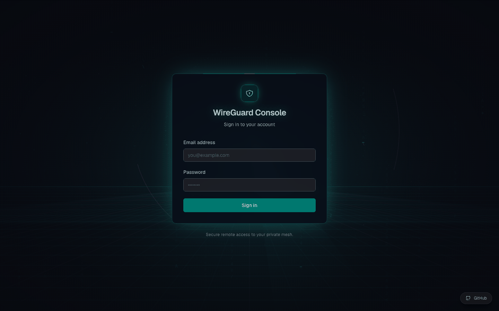
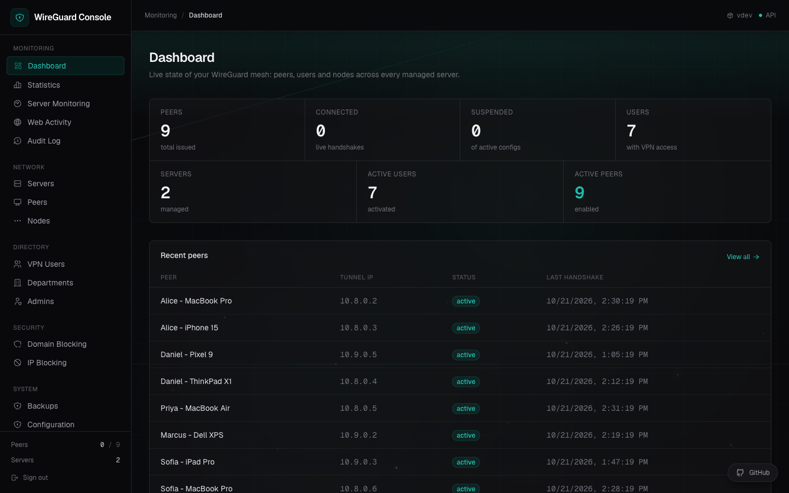
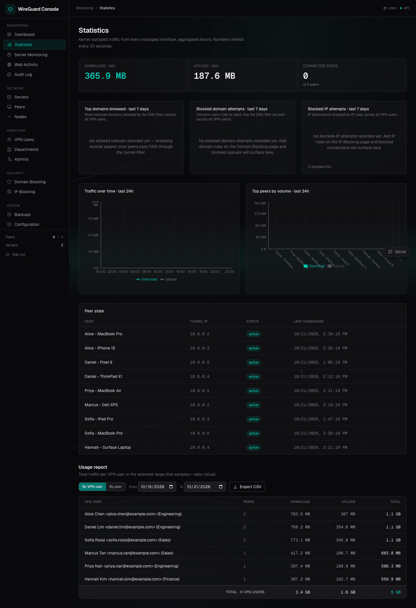
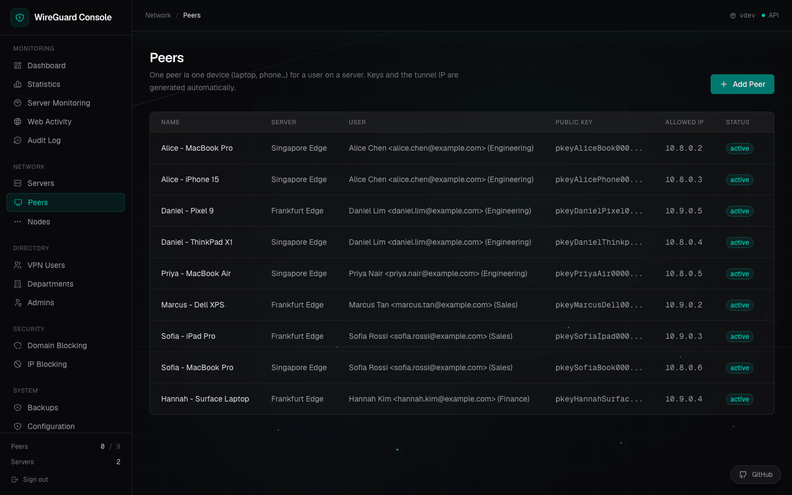
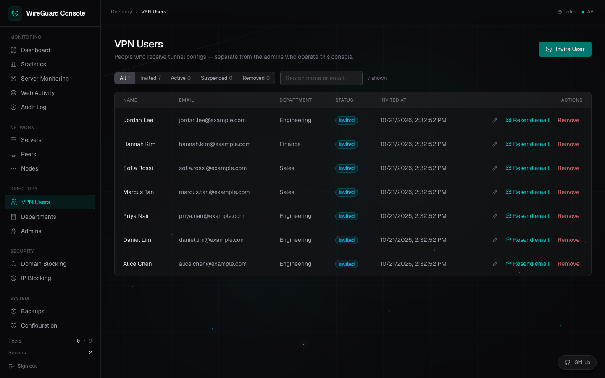
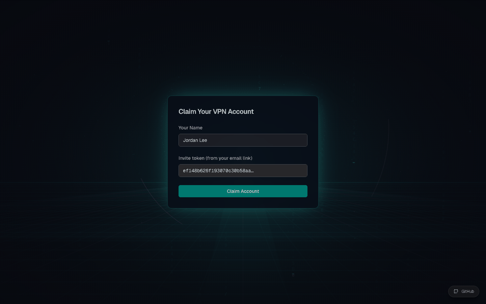

# WireGuard Console

A self-hosted web console for issuing, monitoring, and revoking company WireGuard VPN access — one console, many VPN exit servers across regions.

## Screens

<table>
  <tr>
    <td align="center" width="50%">
      
      <br /><em>Login — self-hosted sign-in with mandatory 2FA for admins</em>
    </td>
    <td align="center" width="50%">
      
      <br /><em>Dashboard — live KPIs and recent peers</em>
    </td>
  </tr>
  <tr>
    <td align="center" width="50%">
      
      <br /><em>Statistics — traffic chart, top peers and usage report</em>
    </td>
    <td align="center" width="50%">
      
      <br /><em>Peers — active/suspended devices, config &amp; QR actions</em>
    </td>
  </tr>
  <tr>
    <td align="center" width="50%">
      
      <br /><em>VPN Users — status tabs, department tags, search and invite</em>
    </td>
    <td align="center" width="50%">
      
      <br /><em>Claim — VPN users claim their peer config from the emailed link</em>
    </td>
  </tr>
</table>

## What you get

- **Admins** (invited, mandatory 2FA) manage everything from the web UI
- **VPN users** claim their own peer config via an emailed invite link, tagged with an optional department
- **Distributed nodes** — add VPN exit machines in any region in ~2 minutes
- **DNS filtering** — global and per-user domain blocking (AdGuard) with reusable domain groups and a branded block page (HTTPS block pages need the console certificate installed once per device)
- **IP blocking** — drop IPv4/IPv6 addresses and CIDR ranges for VPN peers, globally or per-user, with reusable IP groups (enforced server-side before NAT); blocked-IP attempts appear in Statistics and Web Activity
- **Web activity** — per-user browsing history, traffic charts and usage reports (CSV export)
- **Backup & restore** — one-click, 2FA-gated

## Quick start

Requires: Ubuntu 22.04+, Docker (installed automatically), and either a **domain** (recommended) or a public IP.

```bash
curl -fsSL https://raw.githubusercontent.com/garyhooi/wireguard-console/main/install.sh | sudo bash
```

This installs Docker, WireGuard tools and the stack, provisions AdGuard Home, opens the firewall on whichever manager is active (ufw, firewalld, or a bare iptables ruleset), and **asks you for your first `super_admin` email, then prints the auto-generated password at the end** — save them, log in, change the password and enroll 2FA. (A fresh database is detected from the Postgres data volume, so re-running after a reset that wiped Docker data prompts for the email again and prints new credentials instead of silently reusing stale ones.)

**No domain?** Enter the server's public IP when prompted. HTTPS then uses Caddy's internal CA — your browser shows a one-time self-signed warning (the connection is still encrypted). For a trusted certificate without buying a domain, use `CONSOLE_DOMAIN=<your-ip>.sslip.io bash install.sh`.

**Behind Cloudflare?** No prompt: the installer derives the origin shape from the TLS mode, and for a hostname the default is **domain mode** — Caddy obtains a public certificate and serves HTTPS on :443. That is what Cloudflare **Full** and **Full (strict)** expect, and it is also what **Automatic SSL/TLS** expects: Automatic probes your origin over both HTTP and HTTPS and only ever *upgrades* the encryption mode (it never downgrades), so an HTTPS origin lets it settle on Full. Automatic is not "plain HTTP on :80".

Only Cloudflare **Flexible** (Cloudflare talks plain HTTP to the origin) needs the other shape, and it is opt-in instead of guessed:

```bash
curl -fsSL https://raw.githubusercontent.com/garyhooi/wireguard-console/main/install.sh | sudo WGCONSOLE_TLS=external-proxy bash
```

In that mode Caddy serves HTTP only on :80 and — crucially — **does not redirect HTTP→HTTPS**; without it Caddy answers Cloudflare's plain-HTTP origin fetch with `308 → https://…`, Cloudflare forwards it, and the browser loops with `ERR_TOO_MANY_REDIRECTS`. Cloudflare's proxy IP ranges are trusted for `X-Forwarded-*` headers so the API still sees the original client IP and scheme. Prefer switching Cloudflare to **Full** instead — your origin already serves a valid certificate on :443, and Automatic upgrades to Full on its own once it has probed the origin (the rollout is gradual; you can set Full manually right away). After starting the stack the installer probes the public URL and prints the exact fix if it detects the Flexible loop.

**Every run asks and takes your current values as defaults.** Press Enter to keep the domain; the Cloudflare question defaults to your current mode (N = Caddy serves HTTPS on :443, the right answer for Full / Full (strict) / Automatic SSL, or no proxy; Y = Cloudflare Flexible, plain-HTTP origin). This is the only way to change the domain or the Cloudflare answer later without editing `.env` — non-interactive runs (no terminal) keep the stored values, and the env vars below override them for automation:

```bash
CONSOLE_DOMAIN=vpn.example.com sudo bash install.sh   # new domain (WireGuard endpoint follows; peers must re-download their configs)
WGCONSOLE_TLS=domain sudo bash install.sh             # Caddy HTTPS on :443 (Full / Automatic / DNS-only)
WGCONSOLE_TLS=external-proxy sudo bash install.sh     # plain-HTTP origin (Cloudflare Flexible)
```
```

To add more operators: **System → Admins → Invite Admin**. Add VPN users under **Directory → VPN Users**, then issue peers to them.

## Firewall — which ports to open

| Port | Purpose | Open? |
|---|---|---|
| `80/tcp` | Caddy: HTTPS certificate issuance + block page | ✅ |
| `443/tcp` | Console web UI + API | ✅ |
| `3000/tcp` | AdGuard API — Docker containers only (never the internet) | 🔒 internal |
| `53/udp+tcp` | AdGuard DNS for VPN peers (WireGuard interface only) | ✅ on VPN hosts |
| `51820/udp` | WireGuard (use your custom port if you changed it) | ✅ only if this machine also runs a VPN server |

The installer opens these on the **host** firewall itself, whichever manager is active: `ufw`, `firewalld`, or a bare `iptables` ruleset. The last case matters on images that ship an iptables ruleset with a catch-all `REJECT` instead of ufw — some cloud images do (for example Oracle Cloud's Ubuntu images). There, rules are inserted *before* that REJECT (an appended rule never matches, so WireGuard handshakes are silently dropped: "last handshake: never") and re-applied at boot by a `wg-console-firewall.service` unit. That same image ruleset can also shadow ufw: it is loaded before ufw appends its own chains, so every ufw allow rule would be unreachable and the VPN still would not hand-shake. The installer detects that ordering, removes the redundant catch-all REJECT rules (ufw keeps its default DROP policy, so nothing else is exposed) and the boot unit repeats the repair after a reboot. Port 53 is scoped to the WireGuard interface, so tunnel peers reach AdGuard on the gateway while it stays closed to the internet, and port 3000 is opened **only for Docker's private bridge subnets** (172.16.0.0/12) so the console's api container can reach AdGuard's API — AdGuard itself stays closed to the internet. On a **cloud** firewall (OCI Security List/NSG, AWS security group, GCP VPC firewall, Azure NSG) open 80/tcp, 443/tcp and 51820/udp yourself; the installer cannot change those. **Never** open 3000 publicly.

## Distributed nodes (one console, many regions)

A **node** is a machine in another location (e.g. Singapore, Thailand) that runs a tiny agent. After a one-time SSH to install it, the agent **connects out** to your console and polls for changes every 15s — no inbound ports (except WireGuard) and no further SSH needed. You can host the console on one machine and still manage exits everywhere.

### Step-by-step

1. **Install the console** on your main server (see Quick start). Every machine in the stack that runs WireGuard needs a VPN *server* entry and a unique subnet — e.g. `10.8.0.0/24` for the console host, `10.9.0.0/24` for Singapore, `10.10.0.0/24` for Thailand. Never reuse a subnet on two locations.

2. **Register the node** — Console → **Nodes → Add Node**:
   - **Name** — e.g. `Singapore Exit`
   - **Location** — free text, e.g. `SG, ap-southeast-1`
   - Click **Create Node**. The console generates a token and shows a **join command — copy it now** (the token is shown only once).

3. **Run the join command on the node machine** (SSH in, paste, run with sudo). It installs Docker if needed, builds the agent, and starts it:
   ```bash
   curl -fsSL https://raw.githubusercontent.com/garyhooi/wireguard-console/main/node-install.sh | sudo bash -s -- <TOKEN> https://<your-console-domain> <NODE_ID>
   ```

4. **Open the WireGuard port on the node** — the node installer does not touch its firewall:
   ```bash
   sudo ufw allow 51820/udp    # or your custom WireGuard port
   ```
   On a host without ufw that ships a default iptables ruleset (some cloud images do), use iptables instead — insert it before the image's catch-all REJECT:
   ```bash
   sudo iptables -I INPUT 6 -p udp --dport 51820 -j ACCEPT   # any position before the REJECT
   ```
   Outbound needs nothing: the agent only polls your console over HTTPS (443).

5. **Create the VPN server on that node** — Console → **Servers → Add Server**:
   - **Name** — the location, e.g. `Singapore VPN`
   - **Public endpoint** — the node machine's public IP + port, e.g. `203.0.113.10:51820` (this is what peers connect to)
   - **Managed by** → `Node (agent applies it automatically)`
   - **Node** → pick `Singapore Exit`
   - **Network** → a subnet unique to this location, e.g. `10.9.0.0/24`
   - **DNS servers** → never leave empty (peers default to the tunnel gateway, where nothing listens on 53):
     - public resolver, e.g. `1.1.1.1, 8.8.8.8` — simplest
     - the console's public IP, to reuse its AdGuard filtering — first allow DNS from this node on the console: `sudo ufw allow from <node-public-ip> to any port 53 proto udp` (or the equivalent rule for your host firewall).

6. **Wait ~30s and verify.** The console shows the node green/"ok" with a server count; on the node machine `sudo wg show` lists the interface. Add a peer to that server and connect from a device to test the exit.

Repeat steps 2–6 for each location. Deleting a node is safe — its servers fall back to *manual* mode.

> **Note:** remote-node servers currently don't report traffic stats or DNS/web activity — those features track the console host's own AdGuard. Nodes also self-heal after a reboot: the agent re-applies interfaces on its next poll.

## Backup & restore

**System → Backups**: create, download (off-server copy), and restore with one click. Destructive actions ask for your 2FA code. Backups live on the console's Docker volume — download them regularly.

## Upgrading

Re-run the same install command — it updates the code and keeps all admins, peers, and data:

```bash
curl -fsSL https://raw.githubusercontent.com/garyhooi/wireguard-console/main/install.sh | sudo bash
```

**Back up first.** Open **System → Backups** and create one (or download one for an off-server copy) before re-running the installer on a production console.

### Upgrading a node

Run the node installer (not `install.sh`) with the same args as when you joined it:

```bash
curl -fsSL https://raw.githubusercontent.com/garyhooi/wireguard-console/main/node-install.sh | \
  sudo bash -s -- <TOKEN> https://<your-console-domain> <NODE_ID>
```

Lost the token? Nodes → **Join command** re-issues one.

### Version & update hints

The console's top bar shows the installed version and — via a short, cached lookup of this repo's [latest GitHub release](https://github.com/garyhooi/wireguard-console/releases) — flags when a newer release exists. Clicking the version (or the **Update available** chip) shows the exact commands: back up, then run the one-liner above. install.sh stamps `APP_VERSION` (from the repo-root `VERSION` file) into `.env` on every run, so an update is reflected in the top bar as soon as the stack is back up.

## Development

```bash
# Backend (Go)         # Frontend (React/Vite)
cd backend             cd frontend
go run ./cmd/api       bun install && bun run dev
```

Full test suite: `scripts/test.sh`. Manual setup (no installer): `cp .env.example .env`, fill in `CONSOLE_DOMAIN` + secrets, `docker compose up -d --build`.

## License & docs

[Apache 2.0](LICENSE) · Detailed architecture/API docs in [`plan/WIREGUARD CONSOLE BUILD GUIDE.md`](plan/WIREGUARD%20CONSOLE%20BUILD%20GUIDE.md).
